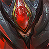
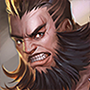
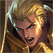
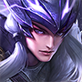

# 중국판 왕자영요 상대법 — 대항로

**기준일:** 2026-11-08 · **사용 영웅:** 원류지자만 사용 · **대상:** 중국 서버 5대 공격로

이 문서는 원류지자 **탱커 형태**로 대항로에 설 때의 라인전과 합류 대응을 정리한다. 영웅명은 중국판 선택 화면 표기를 유지했다. 아래 목록은 Tencent 영웅 데이터의 대항로 추천·겸임 분류를 기준으로 하므로 주 포지션이 다른 영웅도 포함한다. 같은 영웅이 여러 파일에 반복되는 경우는 그 포지션에서도 공식 분로 후보로 표시되어 있기 때문이다.

## 원류지자 탱커 형태의 기본 계획

- 첫 웨이브부터 맞딜을 고집하지 말고, 상대의 진입·제어 기술을 빼고 짧게 되받는다. 체력 우위를 만든 뒤 강가와 정글 입구의 시야를 팀에 열어 준다.
- 상대가 체력 회복·보호막·궁극기 강화에 들어가면 기술을 연달아 쓰지 않는다. 강화가 끝나거나 핵심 기술이 빗나간 직후가 교환 창이다.
- 라인에서 이기기보다 **죽지 않고 라인을 밀어 두고 먼저 합류하는 것**이 팀에 더 큰 이득인 매치업이 많다. 적 정글 위치가 안 보이면 긴 추격을 금한다.
- 회복형 상대에게는 팀의 치유 감소 수단을 고려하고, 적 원딜·마법사가 잘 컸으면 방어 아이템을 그 피해 유형에 맞춘다. 아이템 수치와 효율은 패치마다 달라 게임 안의 최신 설명을 확인한다.

## 매치업

### 대항로 고정·주요 후보

-  **廉颇** — 연속 돌진과 띄우기에 한꺼번에 맞지 않도록 옆으로 피한다. 궁극기 연계가 끝나거나 진입기가 빠진 뒤 짧게 반격한다.
-  **钟无艳** — 석화 한 번으로 교환이 뒤집힐 수 있다. 스킬을 빼기 전에는 붙어서 평타를 주고받지 말고, 석화가 발동한 뒤 빠져나온다.
-  **白起** — 체력이 낮아질수록 강해지고 도발 궁극기로 역전한다. 킬각을 볼 때도 궁극기 사거리 밖에서 체력을 깎고, 도발을 쓴 뒤 마무리한다.
-  **芈月** — 연결 공격과 회복이 이어지는 동안 맞딜하지 않는다. 연결을 끊고 궁극기로 무적이 된 뒤 착지 지점을 보고 다시 압박한다.
-  **吕布** — 참격과 궁극기의 광역 진입이 강하다. 방어막만 믿고 정면 교환하지 말고, 궁극기 표시 범위를 벗어나 착지 후 공격한다.
-  **夏侯惇** — 기절·끌기와 보호막이 함께 돌아갈 때는 교환하지 않는다. 첫 진입을 옆으로 피하고 보호막이 사라진 구간에 짧게 압박한다.
-  **曹操** — 궁극기 회복이 켜진 긴 싸움은 불리하다. 궁극기를 먼저 쓰게 만들고 거리를 벌린 뒤, 지속 시간이 끝난 다음 다시 붙는다.
-  **达摩** — 벽 근처에서 밀려나면 연속 제어에 갇힌다. 벽을 등지지 말고, 궁극기 실패 또는 벽 연계가 끊긴 직후만 반격한다.
-  **项羽** — 밀어내기와 제어로 타워 쪽에 고립시킨다. 미니언과 타워 사이의 직선에 서지 말고, 돌진이 지나간 뒤 측면에서 교환한다.
-  **老夫子** — 궁극기 사슬 범위에 걸리면 긴 시간 맞딜해야 한다. 궁극기 전에는 거리를 유지하고, 사슬이 빗나가거나 끝난 뒤에만 전진한다.
-  **关羽** — 이동을 막지 못하면 밀어내기 연계가 반복된다. 직선으로 달려오는 경로를 옆으로 비켜 서고, 돌진이 끊긴 동안만 맞붙는다.
-  **程咬金** — 체력이 낮아져도 궁극기로 회복하며 버틴다. 회복 궁을 확인하면 추격을 끊고, 회복이 끝나기 전엔 포탑 아래 다이브를 하지 않는다.
-  **刘邦** — 라인에서 사라지면 궁극기로 다른 곳에 합류할 수 있다. 미니언을 빠르게 정리하고 핑으로 알리며, 아군이 교전할 때 혼자 맞딜을 이어가지 않는다.
-  **花木兰** — 침묵과 무거운 검의 제어가 이어지면 탈출이 어렵다. 가벼운 검의 접근기를 피하고, 무거운 검 자세가 끝나거나 주요 제어가 빗나갈 때 반격한다.
-  **亚瑟** — 침묵을 먼저 맞으면 원류지자의 대응 기술을 쓰기 어렵다. 접근 사거리 안에서 기술을 낭비하지 말고, 침묵을 빼고 나서 교환한다.
-  **杨戬** — 표식이 붙은 상태로 오래 싸우면 추격과 회복이 이어진다. 표식 또는 돌진을 피한 뒤 미니언을 사이에 두고, 체력이 낮을 때는 궁극기 처형 사거리를 주지 않는다.
-  **哪吒** — 궁극기로 멀리서 지정 진입해 후열을 압박한다. 궁극기 준비 중에는 아군 원거리 딜러와 떨어지지 말고, 진입한 목표를 함께 보호한다.
-  **梦奇** — 보호막을 두른 채 평타를 계속 쌓는 정면 교환이 강하다. 보호막을 먼저 벗기고 빠지며, 보호막이 비어 있을 때만 재진입한다.
-  **狂铁** — 에너지가 찬 보호막·회복 구간에서 맞딜하면 손해다. 에너지가 낮을 때 교환하고, 강화 기술을 쓴 뒤에는 즉시 거리를 다시 벌린다.
-  **元歌** — 본체와 인형의 위치를 동시에 봐야 한다. 인형이 접근하면 바로 끊거나 후퇴하고, 인형 제어기를 쓴 뒤 드러난 본체를 압박한다.
-  **孙策** — 배를 타고 먼 거리에서 급습할 수 있다. 강가와 시야 밖에서 직선으로 달려오는 경로를 경계하고, 충돌을 피한 뒤 배가 사라진 동안 라인을 민다.
-  **李信** — 원거리 형태의 정리와 근접 형태의 폭발 진입을 구분한다. 원거리 포킹을 억지로 맞교환하지 말고, 형태 전환 뒤의 기술이 빠질 때 짧게 붙는다.
-  **猪八戒** — 전투 중 회복으로 체력을 되돌린다. 회복이 많은 교환을 길게 끌지 말고, 기술을 비운 구간에 집중 공격하거나 치유 감소를 준비한다.
-  **马超** — 창을 줍는 동선에서 빠르게 진입·이탈한다. 창이 놓인 방향과 이동 경로를 따라가지 말고, 창을 회수한 직후의 빈 시간을 노린다.
-  **蒙恬** — 방패 진형 정면에서는 피해를 줄이고 압박한다. 측면을 잡고 진형이 풀릴 때 공격하며, 궁극기 병력과 맞대고 오래 서 있지 않는다.
-  **夏洛特** — 연계가 완성되면 감속과 피해 감소가 겹친다. 연속 표식을 허용하지 말고 첫 연계가 끊긴 뒤에 교환하며, 긴 싸움보다 짧은 견제를 반복한다.
-  **貂蝉** — 표식 폭발과 궁극기 안의 연속 회피·회복으로 근접 맞딜을 길게 끈다. 궁극기 범위 밖으로 물러나고, 이동기가 빠진 뒤 제어를 연결한다.
-  **司空震** — 원거리 견제와 근접 연속 공격, 궁극기 진입을 함께 경계한다. 사거리 안에서 기술을 다 맞지 말고, 궁극기 착지 뒤 강화 시간이 빠질 때 대응한다.
-  **姬小满** — 연속 기술 선택으로 당기기·차기·회복을 바꾼다. 첫 동작에 반응해 기술을 전부 쓰지 말고, 콤보가 끝나며 뒤로 빠지는 구간을 압박한다.
-  **亚连** — 표식이 쌓인 뒤의 연속 공격과 궁극기 진입을 허용하지 않는다. 표식이 적을 때 짧게 교환하고, 궁극기 대상이 되면 아군과 겹쳐 서지 않는다.
-  **元流之子(坦克)** — 같은 탱커 형태와 만나면 스킬을 먼저 소모한 쪽이 불리하다. 첫 기술을 서로 교환하고 보호막·회복 주기를 확인한 뒤, 아군 정글과 함께 진입한다.
-  **影** — 강한 연속 공격과 궁극기 진입이 예상되면 체력을 아껴 둔다. 돌진 직후 즉시 맞딜하지 말고, 강화·회피 동작이 끝난 뒤 제어를 연결한다.
-  **蚩奼** — 평타로 무기와 전투 형태를 바꾸며 회복·공속·제어가 달라진다. 형태가 강해지는 동안 뒤로 물러나고, 돌진·찌르기 또는 궁극기 강화가 빠진 다음 교환한다.

### 다른 주 포지션에서 넘어올 수 있는 후보

-  **赵云** — 낮은 체력에서 강해지는 진입을 경계한다. 체력 우위를 지키며 궁극기를 빼고 반격한다.
-  **庄周** — 궁극기 해제 효과가 켜진 동안 군중 제어를 아낀다. 해제가 끝난 뒤 아군의 제어와 함께 공격한다.
-  **心魔六耳** — 강화 평타와 공중 체공, 궁극기의 선택 불가를 순서대로 사용한다. 공중 동작 중 핵심 제어를 낭비하지 말고 궁극기 종료 후 공격한다.
-  **橘右京** — 긴 사거리의 베기와 기절을 한 번에 맞지 않는다. 기절 기술이 빗나간 뒤 접근한다.
-  **东皇太一** — 궁극기 제압은 아군의 보호·집중 공격이 없으면 위험하다. 혼자 깊게 들어가지 말고, 제압 사거리 밖에서 아군과 함께 대응한다.
-  **铠** — 궁극기 동안 정면 맞딜을 피한다. 강화 지속 시간이 끝날 때까지 제어와 이탈을 아껴 둔다.
-  **苏烈** — 밀어내기와 궁극기 광역 띄우기, 부활로 교전을 뒤집는다. 좁은 벽 근처에 몰리지 말고, 부활을 소모시킨 뒤 다시 교전한다.
-  **嫦娥** — 마나를 보호막처럼 쓰며 버틴다. 마나가 남아 있을 때 긴 교환을 피하고, 보호막이 소진된 시점에 압박한다.
-  **盘古** — 무장 해제에 걸리면 평타 기반 대응이 끊긴다. 도끼 형태의 돌진·제어를 먼저 피하고, 무장 해제 지속이 끝난 뒤 반격한다.
-  **曜** — 표식과 궁극기 되돌아가기로 공격을 흘린다. 궁극기 위치를 기억하고, 되돌아간 뒤 추격한다.
-  **赵怀真** — 공격을 받아내거나 흡수한 뒤 되돌려 주는 기술을 주의한다. 강한 투사체·궁극기를 받아내는 동안 정면에서 전부 쓰지 않는다.
-  **海诺** — 원거리 포킹과 근접 교전, 되돌아가는 궁극기가 있어 추격이 어렵다. 궁극기 귀환 지점을 기억하고, 형태에 따라 거리 조절한다.
-  **大司命** — 표식과 긴 추격으로 체력이 빠진 뒤 마무리한다. 시야 없는 강가에 혼자 서지 말고, 궁극기 진입을 아군과 나눠 받아낸다.

## 이 라인에서 기억할 한 가지

상대 핵심 기술을 맞은 직후가 아니라 **상대가 그 기술을 빼고 난 뒤**에 맞교환한다. 원류지자 탱커는 라인전 승리보다 안전한 파동 정리와 첫 합류가 더 중요하다.

## 참고 기준

- 매치업 초상화는 Tencent 공식 CDN의 영웅 아이콘을 문서 옆 `images/heroes/` 폴더에 저장해 사용한다.

- Tencent 공식 영웅 목록과 포지션 필드: [herolist.json](https://pvp.qq.com/web201605/js/herolist.json) (2026-11-08 조회). `roles`와 `extra_cold_lane` 표기를 추천·겸임 분류에 사용했다.
- 원류지자 다섯 직업 및 전 라인 구성: [왕자영요 S43 시즌 안내](https://www.taptap.cn/game-event/10965).
- 매치업 문장은 기술의 핵심 위협을 기준으로 한 대응 요약이다. 수치·재사용 대기시간·아이템 효율은 패치에 따라 달라질 수 있으므로 게임 내 최신 설명을 우선한다.
