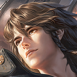
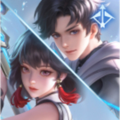

# 중국판 왕자영요 상대법 — 발육로

**기준일:** 2026-11-08 · **사용 영웅:** 원류지자만 사용 · **대상:** 중국 서버 5대 공격로

이 문서는 원류지자 **사수 형태**로 발육로에 설 때의 안전한 파밍·거리 유지·합류 대응을 정리한다. 영웅명은 중국판 선택 화면 표기를 유지했다. Tencent 영웅 데이터의 발육로 추천·겸임 후보를 모두 싣고, 적 유주와 정글의 개입까지 염두에 둔다.

## 원류지자 사수 형태의 기본 계획

- 초반에는 처치보다 미니언과 경험치를 챙긴다. 상대의 사거리·제어기가 더 강하면 체력을 지키며 포탑 쪽에서 받아먹는다.
- 이동·보호 기술을 공격용으로 먼저 쓰지 않는다. 적 정글이 보이지 않거나 적 유주가 수풀에 있을 때는 도주 수단을 보존한다.
- 상대 궁극기나 제어기가 빠졌을 때 짧게 공격하고, 밀어내기·표식·광역 장판이 깔리면 먼저 빠진다.
- 파동을 밀었을 때만 중로 합류나 정글 목표물 지원을 간다. 적 원거리 사수의 사거리를 따라 포탑 밖 깊이 추격하지 않는다.

## 매치업

-  **孙尚香** — 구르기 뒤 강화 포탄으로 짧고 강한 교환을 한다. 구르기 후 포탄을 피하고, 구르기 재사용 전에 역으로 거리를 좁힌다.
-  **鲁班七号** — 표식이 쌓인 뒤 연속 탄환과 수류탄 폭딜이 강하다. 표식이 누적될 때마다 잠시 후퇴하고, 이동기 없는 점을 이용해 수풀 시야를 잡는다.
-  **马可波罗** — 표식이 쌓이면 궁극기로 밀착해 피해를 폭발시킨다. 표식을 여러 번 맞지 말고, 궁극기 진입 시 밀어내기·제어를 바로 사용한다.
-  **狄仁杰** — 제어 해제와 순간 무적으로 진입을 끊는다. 해제 기술을 먼저 빼고, 그 뒤의 제어·궁극기를 맞춘다.
-  **后羿** — 느리지만 긴 사거리와 전역 기절 화살이 위험하다. 직선 시야에 오래 서 있지 말고, 적이 사라진 순간 궁극기 화살을 경계한다.
-  **李元芳** — 표식 부착 후 폭발 피해와 수풀 감지가 강하다. 표식이 붙으면 아군과 떨어져 폭발을 나누고, 수풀을 확인할 때 혼자 들어가지 않는다.
-  **虞姬** — 물리 공격 무효 기술 때문에 원류지자 사수의 평타 교환이 끊긴다. 해당 기술을 먼저 쓰게 만든 뒤 공격하며, 무효 지속 중에는 거리를 유지한다.
-  **黄忠** — 설치형 궁극기 안에서 사거리와 방어가 높아진다. 궁극기 포격 범위를 벗어나고, 아군과 측면 진입을 맞춰 포탑을 지킨다.
-  **百里守约** — 조준 저격과 함정으로 체력을 깎고 길목을 막는다. 예측 가능한 직선 이동을 멈추고, 함정·저격을 사용한 뒤 웨이브를 밀어낸다.
-  **公孙离** — 우산을 던지고 되돌아가며 투사체를 피한다. 우산 위치를 보며 기술을 아끼고, 우산이 멀리 놓인 짧은 구간에 압박한다.
-  **伽罗** — 긴 사거리와 둔화로 거리를 유지하며 보호막을 빠르게 벗긴다. 장거리 교환을 받아주지 말고, 아군 제어와 함께 접근한다.
-  **蒙犽** — 연사와 궁극기 지원이 강해 한 방향으로 달아나면 맞기 쉽다. 좌우로 움직이며 사격을 피하고, 궁극기 사거리 안에서 오래 교전하지 않는다.
-  **艾琳** — 이동형 공격과 마법 피해로 전통적인 방어 계산을 흔든다. 지속 견제를 피하며 이동기를 남겨 두고, 공격 동작 중 사거리 밖에서 맞대응한다.
-  **戈娅** — 탈것의 이동과 가속·궁극기 끌어당기기로 위치를 흔든다. 직선 추격 대신 수비 위치를 지키고, 궁극기 장판이 깔리면 가장자리부터 벗어난다.
-  **莱西奥** — 공중 이동과 은신으로 짧은 표적 공격을 피한다. 공중 도약 후 착지 위치를 보고 제어를 연결하고, 은신 중에는 수풀을 단독으로 확인하지 않는다.
-  **敖隐** — 원소 공격과 궁극기 비행으로 교전을 시작·종료한다. 궁극기 비행 동안 추격 기술을 쓰지 말고, 착지 이후 제어를 맞춘다.
-  **苍** — 늑대와 함께 공격해 접근하는 적을 밀어낸다. 늑대가 붙은 동안 정면으로 돌진하지 말고, 소환수와 본체가 분리될 때 옆에서 공격한다.
-  **元流之子(射手)** — 같은 사수 형태는 강화 평타와 이동 연계로 교환한다. 보호·이동 기술을 먼저 뺀 쪽이 불리하므로 상대가 먼저 사용하도록 압박한다.
-  **孙权** — 군기와 화살비로 표식을 쌓은 뒤 궁극기 돌진으로 마무리한다. 표식이 차기 전에 거리를 벌리고, 군기 주변 화살비를 밟지 않는다.

### 다른 주 포지션에서 발육로로 올 수 있는 후보

-  **扁鹊** — 중독을 쌓는 평타·기술과 회복 궁극기가 사수의 짧은 교환을 약화한다. 독을 중첩시키지 말고, 중독이 적은 순간만 압박한다.
-  **元歌** — 인형이 사수의 위치를 확인하고 제어 후 본체가 마무리한다. 인형이 보이면 포탑 쪽으로 이동하고, 인형 제어를 쓴 뒤 본체를 확인한다.
-  **李信** — 원거리 형태는 포격, 근접 형태는 돌진·폭발을 노린다. 시야 밖 포킹을 피하고 형태 전환 뒤 접근기를 쓴 순간 공격한다.
-  **司空震** — 원거리 견제 후 궁극기 변신으로 밀착한다. 궁극기 진입이 보이면 보호기를 아끼지 말고, 변신 지속 시간 동안 아군에게 붙는다.
-  **蚩奼** — 평타로 형태를 바꾸며 회복과 강화 공격을 쌓는다. 교전이 길어지기 전에 이탈하고, 돌진 제어와 궁극기 강화가 빠진 순간만 공격한다.
-  **阿古朵** — 소환수와 정글 자원을 이용해 라인에 압박을 더한다. 소환수에 기술을 전부 쓰지 말고, 본체가 나타난 반대쪽에서 파밍한다.

## 발육로에서 기억할 한 가지

도주 기술을 쓰고도 살아남는 위치를 먼저 만든 뒤 공격한다. 원류지자 사수는 **한 번의 긴 추격보다 안전하게 웨이브를 모아 다음 목표물에 합류하는 것**이 더 꾸준한 이득이다.

## 참고 기준

- 매치업 초상화는 Tencent 공식 CDN의 영웅 아이콘을 문서 옆 `images/heroes/` 폴더에 저장해 사용한다.

- Tencent 공식 영웅 목록과 포지션 필드: [herolist.json](https://pvp.qq.com/web201605/js/herolist.json) (2026-11-08 조회). `roles`와 `extra_cold_lane`에 발육로로 표시된 후보를 포함했다.
- 원류지자 다섯 직업 형태: [왕자영요 S43 시즌 안내](https://www.taptap.cn/game-event/10965).
- 매치업 문장은 기술의 핵심 위협을 기준으로 한 대응 요약이다. 패치별 수치와 아이템 효율은 게임 내 최신 설명을 우선한다.
