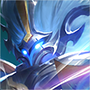
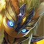

# 중국판 왕자영요 상대법 — 유주

**기준일:** 2026-11-08 · **사용 영웅:** 원류지자만 사용 · **대상:** 중국 서버 5대 공격로

이 문서는 원류지자 **보조 형태**로 유주를 맡을 때의 시야·보호·교전 대응을 정리한다. 영웅명은 중국판 선택 화면 표기를 유지했다. Tencent 영웅 데이터에서 유주 추천 또는 겸임 포지션으로 표시된 전 영웅을 포함한다. 보조끼리의 맞대결은 라인전 킬보다 시야와 첫 교전의 보호 가치가 더 크다.

## 원류지자 보조 형태의 기본 계획

- 시작부터 적 정글의 첫 동선과 아군 정글의 진입을 돕고, 발육로에 계속 붙어 경험치만 나누지 않는다. 다만 원딜이 웨이브를 안전하게 받을 수 있는지는 확인한다.
- 수풀을 확인할 때 원류지자 혼자 몸으로 열지 않는다. 팀원과 함께 시야를 만들고, 적의 갈고리·매혹·제압이 빠진 뒤 전진한다.
- 상대 암살자가 들어오기 전까지 보호·밀어내기·회복 기술을 남긴다. 공격 시작이 이득이어도 후열을 지킬 수 없는 각이면 먼저 걸지 않는다.
- 강가 시야를 잡은 뒤 적 정글을 따라 깊게 들어가지 않는다. 큰 목표물 전에 아군에게 수풀 위치와 적의 이동 방향을 핑으로 알려 준다.

## 매치업

-  **廉颇** — 여러 차례 돌진과 띄우기로 후열에 닿는다. 첫 진입을 빼고 밀어내기·제어를 남겨 마지막 도약을 끊는다.
-  **墨子** — 긴 사거리 기절 포킹이 원딜의 파밍을 막는다. 미니언 뒤에 서고, 기절 발사 후에는 시야를 넓히며 상대 발육로를 압박한다.
-  **庄周** — 궁극기 해제로 아군 제어를 풀어 낸다. 해제 직후 제어를 한꺼번에 쓰고, 해제 전에는 위치를 밀어내는 데 집중한다.
-  **刘禅** — 포탑을 멈추고 기절을 연달아 넣는 다이브형 보조다. 포탑 다이브 때 밀어내기를 아끼고, 적의 첫 제어 후 반격한다.
-  **孙膑** — 팀 가속과 시간 되감기, 궁극기 침묵으로 교전 속도를 바꾼다. 적의 가속이 켜졌으면 무리하게 추격하지 말고, 궁극기 침묵 이후 후열을 다시 정렬한다.
-  **牛魔** — 다수 띄우기·밀어내기와 방어 보조가 강하다. 좁은 강가 수풀에서 나란히 서지 말고, 궁극기 범위를 피한 뒤 아군 딜러를 지킨다.
-  **张飞** — 분노가 차면 궁극기로 전방을 밀고 보호막을 준다. 변신 전에 원딜에게 보호를 제공하고, 변신 후에는 시간·거리를 벌린다.
-  **钟馗** — 갈고리 한 번으로 아군을 끌어가 인원 차이를 만든다. 시야 없는 좁은 통로를 피하고, 갈고리가 빗나가면 즉시 시야를 전진시킨다.
-  **蔡文姬** — 광역 회복과 제어로 적의 장기 교전을 돕는다. 치유 감소를 팀과 조율하고, 회복 궁극기 중에는 핵심 제어를 겹치지 않는다.
-  **太乙真人** — 폭발 제어와 부활 궁극기로 킬 교환을 뒤집는다. 적 부활 효과가 남아 있으면 원딜의 궁극기·폭딜을 아끼고, 부활 직후 다시 제어한다.
-  **大乔** — 순간이동·귀환으로 적을 보내고 다시 불러 인원 수를 바꾼다. 포털이 열린 위치를 팀에 알리고, 원딜이 혼자 이동하지 않게 붙는다.
-  **东皇太一** — 제압 궁극기는 한 명을 묶고 아군의 공격을 끌어온다. 원딜과 겹쳐 서지 말고, 제압 대상에게 보호·집중 공격을 동시에 연결한다.
-  **鬼谷子** — 은신과 가속 후 여러 명을 한꺼번에 당긴다. 시야 없이 수풀 가까이 서지 말고, 적 가속이 보이면 팀을 양옆으로 흩어 놓는다.
-  **苏烈** — 밀어내기와 연속 띄우기, 부활 특성으로 교전을 오래 만든다. 궁극기 준비를 보면 흩어지고, 부활 대기 동안 목표물에 무리하게 들어가지 않는다.
-  **明世隐** — 연결한 아군의 공격력·이동을 보조해 원딜 싸움을 강하게 만든다. 연결 대상을 무작정 맞딜하지 말고 연결을 끊을 수 있는 각으로 이동한다.
-  **盾山** — 방패로 투사체와 원거리 진입을 막는다. 투사체를 방패에 낭비하지 말고, 측면·근접 진입으로 방패 방향을 돌린다.
-  **瑶** — 아군에게 붙어 보호막과 제어를 제공한다. 보호막이 생긴 적을 즉시 폭딜하지 말고, 분리·제어 후 보호막 재사용 시간을 노린다.
-  **鲁班大师** — 연결한 아군을 끌어당기거나 함께 돌진시킨다. 연결 표식이 붙은 후열은 벽·수풀 가까이 가지 않게 하고, 적의 이동 연계가 끝난 뒤 반격한다.
-  **桑启** — 수풀과 회복을 활용해 아군을 유지하고 기습을 돕는다. 수풀 주변에서 시야를 먼저 만들고, 치유를 받는 적에게는 짧은 교전을 반복한다.
-  **朵莉亚** — 아군 궁극기를 다시 쓰게 만들어 교전의 핵심 기술을 반복한다. 적 궁극기를 본 뒤에도 첫 사용만으로 싸움이 끝났다고 보지 않는다.
-  **少司缘** — 표식과 회복·이동 보조로 팀 간 교환을 유리하게 만든다. 표시된 아군을 단독으로 두지 말고, 표식 대상과 연결된 적을 함께 견제한다.
-  **空空儿** — 분신으로 위치를 바꾸고 강화 평타로 장비·이동을 방해한다. 본체와 분신을 구분하고, 위치 교환 후 진짜 본체가 드러날 때 제어한다.
-  **元流之子(辅助)** — 아군을 보조하는 다섯 번째 형태로, 보호·강화와 라인 지원이 핵심이다. 보조 효과가 붙은 원딜과 긴 교환을 피하고, 기술이 빠진 타이밍에 적 딜러를 압박한다.
-  **大禹** — 설치한 솥으로 시야·회복·이동 경로를 만들고 솥으로 순간이동한다. 솥 근처에서 한곳에 모이지 말고, 순간이동 착지의 제어 범위를 피해 원딜을 보호한다.
-  **卢雅那** — 이동·원거리 공격과 시야를 흔드는 기술로 후열을 압박한다. 궁극기 실명·제어 범위에서 빠져나오고, 이동기가 빠진 동안 아군 사수가 공격할 공간을 만든다.

### 다른 주 포지션에서 유주로 올 수 있는 후보

-  **夏侯惇** — 끌기·기절·보호막을 겸해 진입과 보호를 모두 한다. 제어 연계를 원딜에게 다 쓰게 만들고, 빠진 뒤 후열을 지킨다.
-  **项羽** — 적을 밀어내거나 타워 쪽으로 고립시킨다. 라인 직선에 서지 말고, 밀어내기 뒤 아군에게 보호 기술을 쓴다.
-  **关羽** — 빠른 이동 후 측면에서 아군을 밀어낸다. 직선 돌진 경로에 수풀 시야를 두고, 접근이 시작되면 원딜과 벽을 등지지 않는다.
-  **姜子牙** — 긴 사거리 충전 공격과 밀어내기로 진입을 방해한다. 충전 공격을 좌우로 피하고, 궁극기 준비 중에는 팀을 사선으로 흩어 놓는다.
-  **刘邦** — 궁극기로 다른 라인의 아군에게 보호막을 주며 합류한다. 맵에서 사라진 순간 핑을 보내고, 합류 후 보호막이 끝날 때 반격한다.
-  **王昭君** — 둔화·빙결·궁극기 장판으로 진입을 차단한다. 좁은 수풀 교전을 피하고, 아군이 얼기 전에 밀어내기·보호를 준비한다.
-  **张良** — 확정 제압으로 암살자를 붙든다. 아군 주요 딜러와 간격을 벌리고, 제압 대상에게 회복·방어를 집중한다.
-  **杨玉环** — 광역 피해와 회복, 선택 불가 궁극기로 팀 교전을 늘린다. 궁극기가 빠지기 전에는 집중 공격을 분산하지 말고 후열을 보호한다.
-  **西施** — 끌기와 궁극기 연계로 아군을 따로 떼어 낸다. 끌기 방향을 예측해 원딜과 겹쳐 서지 않고, 이동 제한 구역을 빠르게 벗어난다.
-  **金蝉** — 이동기를 제한하고 대상 피해를 줄여 암살을 막는다. 적의 이동 제한 안에서 진입하지 말고, 기술이 끝난 뒤 압박한다.
-  **赵怀真** — 투사체를 받아내고 되돌려 사수의 공격을 무력화한다. 흡수 자세를 보면 평타·궁극기 투사체를 아끼고 옆으로 돌아간다.
-  **扁鹊** — 중독 중첩과 회복 궁극기로 긴 싸움에 강하다. 원딜이 독 표식을 오래 쌓이지 않게 보호하고, 팀의 치유 감소 타이밍을 맞춘다.
-  **元流之子(坦克)** — 앞라인에서 제어와 보호를 제공한다. 제어기를 한 번에 쓰지 말고 적 암살자의 진입에 한 번은 남겨 둔다.

## 유주에서 기억할 한 가지

보조가 먼저 보여 주는 정보가 교전 결과를 바꾼다. 시야를 열 때 **원딜의 탈출 경로와 적 정글의 진입 방향을 함께 확보**하고, 혼자 깊이 들어가 죽는 시야 확인은 피한다.

## 참고 기준

- 매치업 초상화는 Tencent 공식 CDN의 영웅 아이콘을 문서 옆 `images/heroes/` 폴더에 저장해 사용한다.

- Tencent 공식 영웅 목록과 포지션 필드: [herolist.json](https://pvp.qq.com/web201605/js/herolist.json) (2026-11-08 조회). `roles`와 `extra_cold_lane`에 유주로 표시된 후보를 포함했다.
- 원류지자 보조 형태를 포함한 다섯 직업 안내: [왕자영요 S43 시즌 안내](https://www.taptap.cn/game-event/10965).
- 매치업 문장은 기술의 핵심 위협을 기준으로 한 대응 요약이다. 패치별 수치와 아이템 효율은 게임 내 최신 설명을 우선한다.
