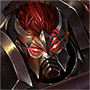
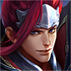
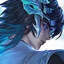
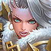
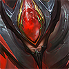
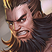
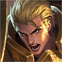
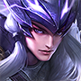
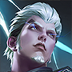

# 중국판 왕자영요 상대법 — 정글

**기준일:** 2026-11-08 · **사용 영웅:** 원류지자만 사용 · **대상:** 중국 서버 5대 공격로

이 문서는 원류지자 **암살자 형태**를 정글로 운용할 때의 동선·역갱·목표물 대응을 정리한다. 영웅명은 중국판 선택 화면 표기를 유지했다. 아래 목록은 Tencent 영웅 데이터에서 정글 추천 또는 겸임 분류가 있는 전 영웅을 포함한다. 다른 라인 문서와 이름이 겹쳐도, 여기서는 정글에서 만날 때의 대응을 설명한다.

## 원류지자 암살자 형태의 기본 계획

- 시작 전에 양쪽 라인의 초반 제어기와 적 정글의 첫 캠프를 고려해 첫 동선을 정한다. 초반 1대1이 강한 상대와 시야 없이 강가에서 맞닥뜨리지 않는다.
- 갱킹 때 진입기 전부를 한 번에 쓰지 않는다. 첫 진입 뒤 빠져나올 이동기나 제어를 하나 남기고, 적의 무적·해제·역진입이 빠진 다음 마무리한다.
- 적 정글이 보이지 않으면 반대편 캠프·강가 시야로 위치를 추정한다. 작은 교전에서 이득을 본 직후 용·정령·적 캠프 중 하나로 확실히 전환한다.
- 침묵·제압·기절이 많은 조합에는 혼자 후열을 파고들지 않는다. 아군 제어가 시작된 뒤 들어가고, 목표물을 처치한 뒤 남은 이동기로 이탈한다.

## 매치업

### 정글 주 포지션 후보

-  **赵云** — 궁극기 착지 후 폭발 피해와 낮은 체력 대상 추격이 강하다. 선진입을 피하고, 궁극기 사용 뒤 역갱·목표물 싸움을 연다.
-  **阿轲** — 시야 밖 접근과 후방 치명타가 핵심이다. 후열을 혼자 두지 말고, 은신 흔적·접근 방향을 확인한 뒤 팀과 함께 끊는다.
-  **孙悟空** — 기술 뒤 강화 평타로 빠르게 폭딜한다. 첫 강화 평타를 받아낼 수 있는 아군 뒤에서 기다리고, 돌진·궁극기 사용 뒤 반격한다.
-  **典韦** — 궁극기 뒤 지속 추격과 고정 피해가 강해 근접 맞딜이 위험하다. 둔화·제어를 먼저 걸고 거리를 벌려 궁극기 시간을 소모시킨다.
-  **宫本武藏** — 지정 궁극기로 핵심 딜러를 붙잡고 회복을 줄인다. 후열과 함께 서서 한 명만 고립되지 않게 하고, 궁극기 후 짧은 시간에 집중 제어한다.
-  **李白** — 표식과 연속 이동 후 선택 불가 궁극기로 피해를 피한다. 잔상·복귀 위치를 기억하고, 궁극기가 빠진 다음 팀 제어를 겹친다.
-  **露娜** — 표식을 소모해 이동기를 연속 초기화한다. 아군에게 표식이 남지 않게 흩어 서고, 진입 콤보를 끊을 제어를 보존한다.
-  **韩信** — 벽을 넘는 다수의 이동기로 캠프와 라인을 빠르게 오간다. 한쪽 강가에 시야를 두고 반대쪽 자원을 챙기며, 이동기 사용 후만 추격한다.
-  **兰陵王** — 은신 경고 후 후열을 기습한다. 경고가 뜨면 단독 파밍을 멈추고 아군과 뭉치며, 은신 해제 후 제어를 집중한다.
-  **娜可露露** — 궁극기 진입과 표식 폭발로 한 명을 삭제한다. 물몸 딜러를 단독으로 두지 말고, 하강 지점에 즉시 제어를 넣는다.
-  **刘备** — 가까운 거리에서 탄환을 몰아넣고 궁극기로 제어를 막는다. 좁은 지형에서 맞딜하지 말고, 궁극기를 빼낸 뒤 사거리 밖으로 물러난다.
-  **雅典娜** — 돌진 반복과 표식 폭발로 목표를 쫓는다. 진입 경로를 아군과 겹치게 만들고, 표식이 쌓인 대상은 바로 보호한다.
-  **百里玄策** — 사슬에 맞으면 끌려가고 처치 뒤 연계가 이어진다. 사슬의 직선 경로를 피하고, 연결 실패 후 짧게 반격한다.
-  **裴擒虎** — 초반 두 형태를 이용해 침입·강가 싸움을 강요한다. 아군 라인 지원이 없으면 버프를 혼자 지키지 말고, 반대편 자원 교환을 택한다.
-  **司马懿** — 침묵 뒤 빠르게 진입하고 궁극기로 거리를 좁힌다. 첫 침묵을 맞을 위치에 홀로 있지 말고, 진입 후 이탈 기술이 빠졌을 때 공격한다.
-  **云中君** — 이동 경로와 표식 누적을 이용해 고립된 대상을 쫓는다. 벽을 넘어오는 진입을 대비해 강가 시야를 두고, 표식이 쌓이면 아군 쪽으로 빠진다.
-  **镜** — 분신과 거울 영역 안에서 짧은 간격으로 왕복 공격한다. 거울 가장자리와 본체 위치를 보며 제어를 분신에 낭비하지 않는다.
-  **阿古朵** — 정글 몬스터를 빠르게 흡수하고 소환수와 함께 포탑을 압박한다. 소환수에 스킬을 낭비하지 말고, 본체가 드러난 순간 제어와 목표물 압박을 겹친다.
-  **澜** — 물결을 타고 접근해 체력이 낮은 적을 처형한다. 체력이 낮은 아군은 후퇴시키고, 잠수 상태에서 보이지 않을 때 강가를 단독으로 통과하지 않는다.
-  **云缨** — 창술의 층을 쌓아 제어·회복·감소 피해를 바꾼다. 기술을 모두 맞받지 말고, 강화 창술을 쓴 직후 역진입한다.
-  **暃** — 벽 위 이동으로 예상 밖의 각에서 진입한다. 벽에 붙은 사각을 확인하고, 벽에서 내려온 뒤의 공격에 제어를 집중한다.
-  **大司命** — 표식을 남기고 긴 추격으로 후열을 압박한다. 목표물 전투 전 체력을 아끼고, 궁극기 강제 교전을 아군과 함께 받아낸다.
-  **影** — 강화 공격과 궁극기 진입으로 전투를 빠르게 끝내려 한다. 첫 돌진을 피한 뒤 제어를 남기고, 강화가 끝나기 전엔 단독 추격하지 않는다.
-  **元流之子(刺客)** — 같은 암살자 형태끼리는 먼저 모든 이동기를 쓴 쪽이 역습에 취약하다. 남은 층과 이탈 경로를 계산하고, 상대의 마지막 진입 뒤 맞받는다.
-  **王维** — 빈번한 피해 회피와 밀어내기·둔화로 맞교환을 끊는다. 표시된 회피 자원이 남아 있을 때 폭딜을 낭비하지 말고, 회피 발동 직후 다시 진입한다.

### 다른 주 포지션에서 정글로 올 수 있는 후보

-  **钟无艳** — 석화와 근접 제어를 강가에서 맞지 않게 간격을 둔다. 석화가 빠진 뒤 작은 교전을 열고, 좁은 입구에서 혼자 싸우지 않는다.
-  **心魔六耳** — 공중 회피와 궁극기 선택 불가를 가진다. 큰 제어를 공중 동작에 쓰지 말고, 궁극기 종료 후 집중한다.
-  **白起** — 궁극기 도발로 목표물 앞에서 역전을 만든다. 드래곤 입구에서 먼저 맞지 말고, 도발을 쓴 뒤 목표물을 다시 친다.
-  **芈月** — 지속 회복과 무적 궁극기로 소규모 전투를 길게 만든다. 연결 공격을 피하며 짧게 싸우고, 궁극기 종료 후 추격한다.
-  **夏侯惇** — 다중 제어와 보호막으로 진입을 막는다. 먼저 제어를 빼고, 보호막이 끝난 구간에 후속 딜을 넣는다.
-  **曹操** — 궁극기 회복을 켠 상태의 추격전이 강하다. 궁극기를 빼고 재교전하거나, 다른 목표물을 먼저 챙긴다.
-  **程咬金** — 회복 궁극기로 체력을 채우며 추격한다. 치유 감소가 없다면 긴 추격을 끊고, 궁극기 시간 동안 다른 캠프를 먹는다.
-  **橘右京** — 긴 사거리 기절과 순간 폭딜을 강가 수풀에서 노린다. 수풀을 먼저 확인하고, 기절이 빗나간 뒤 반격한다.
-  **亚瑟** — 침묵으로 연계 기술 사용을 막는다. 교전 시작에 침묵을 맞지 않도록 거리를 유지하고, 침묵 후 안전하게 이탈한다.
-  **李元芳** — 표식 폭발과 수풀 시야 확인으로 목표물 싸움이 빠르다. 표식이 붙은 아군과 떨어지고, 궁극기 장판 밖으로 나와 싸운다.
-  **杨戬** — 체력이 낮은 목표를 향한 돌진과 회복이 반복된다. 체력이 빠진 아군을 후퇴시키고, 표식 없는 상태에서 반격한다.
-  **哪吒** — 궁극기 전역 진입으로 후열을 끊는다. 용을 치기 전에 라인 상태를 확인하고, 지정된 아군에게 방어·제어를 맞춘다.
-  **诸葛亮** — 표식을 쌓은 뒤 처형 궁극기로 연속 킬을 노린다. 궁극기를 대신 막을 아군이 없으면 체력이 낮은 팀원이 먼저 빠진다.
-  **铠** — 궁극기 중 폭발적인 일대일 전투가 강하다. 좁은 길목에서 만나면 싸움을 피하고, 지속 시간이 끝난 뒤 재진입한다.
-  **梦奇** — 보호막·평타 기반으로 초반 침입을 버틴다. 보호막이 켜진 본체에 전부 던지지 말고, 적의 백업이 오기 전에 후퇴 경로를 확보한다.
-  **杨玉环** — 광역 피해와 회복, 궁극기 무적으로 전투 시간을 늘린다. 궁극기를 쓰기 전 후열을 한꺼번에 몰지 말고, 종료 후 목표물을 잡는다.
-  **孙策** — 배 궁극기로 멀리서 합류해 목표물 전투를 연다. 정글 입구 직선 경로를 시야에 두고, 충돌 후 분리된 적을 노린다.
-  **嫦娥** — 마나 보호막과 궁극기 연속 피해로 근접 교전을 강요한다. 폭딜을 궁극기 안에 남발하지 말고, 보호막이 약해진 뒤 제압한다.
-  **猪八戒** — 좁은 정글에서 벽·제어와 회복으로 오래 버틴다. 벽에 갇히지 않게 넓은 공간으로 유인하고, 팀의 집중 공격으로 짧게 끝낸다.
-  **盘古** — 무장 해제와 제어로 평타 의존 캐릭터를 막는다. 무장 해제 사거리 밖에서 시작하고, 해제 후 목표물을 다시 친다.
-  **曜** — 궁극기 되돌아가기와 표식으로 진입·이탈을 반복한다. 잔상 위치에 제어를 남겨 두고, 복귀 이후에 팀의 공격을 집중한다.
-  **马超** — 창을 주우며 긴 거리에서 연속 진입한다. 창이 놓인 쪽으로 쫓아가지 말고, 창을 놓치는 구간에 역갱한다.
-  **赵怀真** — 적의 공격·투사체를 받아내고 전투를 되돌린다. 주요 투사체를 막는 자세 중에는 궁극기와 폭딜을 아끼고, 자세가 끝난 뒤 교전한다.
-  **司空震** — 궁극기 변신 후 원거리·근거리 타격과 제어가 강해진다. 변신을 확인하면 후퇴해 시간을 빼고, 끝난 뒤 다시 목표물을 친다.
-  **苍** — 늑대 소환수와 원거리 공격으로 진입로를 방어한다. 늑대가 붙은 상태에서 추격하지 말고, 시야 밖에서 본체로 우회한다.
-  **蚩奼** — 공격 횟수에 따라 형태와 제어가 강화된다. 강화 평타 누적을 허용하지 말고, 제어·돌진이 빠진 다음 교전한다.
-  **元流之子(坦克)** — 탱커 형태는 제어·회복으로 입구를 버틴다. 혼자 길게 맞딜하지 말고, 후열과 겹쳐 들어갈 때 먼저 제어를 건다.

## 정글에서 기억할 한 가지

적 정글을 쫓아다니기보다 **첫 위치를 읽고 반대편 자원을 챙긴 뒤, 다음 목표물에서 먼저 합류**한다. 원류지자 암살자는 진입 횟수보다 마지막 탈출 수단을 남기는 것이 중요하다.

## 참고 기준

- 매치업 초상화는 Tencent 공식 CDN의 영웅 아이콘을 문서 옆 `images/heroes/` 폴더에 저장해 사용한다.

- Tencent 공식 영웅 목록과 포지션 필드: [herolist.json](https://pvp.qq.com/web201605/js/herolist.json) (2026-11-08 조회). `roles`와 `extra_cold_lane`에 정글로 표시된 후보를 포함했다.
- 원류지자 암살자 형태의 정글 포지션 안내: [왕자영요 S43 시즌 안내](https://www.taptap.cn/game-event/10965).
- 매치업 문장은 기술의 핵심 위협을 기준으로 한 대응 요약이다. 패치별 수치와 아이템 효율은 게임 내 최신 설명을 우선한다.
