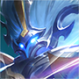

# 중국판 왕자영요 상대법 — 중로

**기준일:** 2026-11-08 · **사용 영웅:** 원류지자만 사용 · **대상:** 중국 서버 5대 공격로

이 문서는 원류지자 **법사 형태**로 중로를 설 때의 라인 정리·시야·합류 대응을 정리한다. 영웅명은 중국판 선택 화면 표기를 유지했다. Tencent 영웅 데이터의 중로 추천·겸임 후보를 모두 싣고, 각 항목은 원류지자 법사 형태를 기준으로 정리했다.

## 원류지자 법사 형태의 기본 계획

- 첫 목표는 상대를 잡는 것이 아니라 웨이브를 안전하게 정리하고 먼저 움직이는 것이다. 적 정글이 안 보이면 강가 수풀에 먼저 들어가지 않는다.
- 상대의 기절·매혹·끌기·제압이 빠지기 전에는 앞으로 걸어가 견제하지 않는다. 기술을 빼도록 짧게 압박하고, 빗나간 직후에만 추가 공격한다.
- 로밍은 웨이브를 정리한 뒤 시작한다. 이동 중 수풀을 통과하지 말고 아군 정글 또는 유주와 함께 시야를 만든다.
- 적이 무적·선택 불가·해제 기술을 보유하면 궁극기를 한 번에 겹치지 않는다. 해당 생존기가 끝난 뒤 집중 피해를 넣는다.

## 매치업

-  **小乔** — 부채 견제와 띄우기 뒤 궁극기 연계가 위협이다. 부채를 피한 뒤 접근하고, 폭풍 궁극기 안에서 정면 맞딜하지 않는다.
-  **墨子** — 긴 사거리 기절과 보호막을 반복한다. 일직선 포킹을 피하고 기절 발사 후 라인을 정리해 먼저 합류한다.
-  **妲己** — 지정 매혹에 맞으면 연계 폭딜을 피하기 어렵다. 수풀 시야 없이 선두에 서지 말고 매혹을 빼거나 미니언 뒤에서 대응한다.
-  **嬴政** — 긴 궁극기 직선 포격으로 퇴로까지 막는다. 궁극기 방향과 직각으로 움직이고, 포격이 끝나면 빈 라인을 빠르게 정리한다.
-  **高渐离** — 궁극기 진입 후 근거리 광역 피해가 강하다. 궁극기 범위 밖으로 물러나 제어를 아끼고, 지속 시간이 끝난 뒤 공격한다.
-  **扁鹊** — 중독 표식과 누적 회복이 길게 싸울수록 유리하다. 중독을 쌓아 주지 말고 짧게 교환하며, 팀이 회복 감소 수단을 고려한다.
-  **周瑜** — 불길 구역을 넓혀 길목을 차단한다. 불길을 가로질러 억지 진입하지 말고, 바깥쪽 웨이브를 정리한 뒤 옆 라인으로 이동한다.
-  **甄姬** — 얼음 표식이 쌓이면 연속 빙결과 궁극기 장판이 이어진다. 아군끼리 겹쳐 서지 말고, 첫 제어 후 거리를 벌린다.
-  **武则天** — 전역 궁극기로 위치를 노출하고 기절을 건다. 체력이 낮은 상태로 전장 중심에 남지 말고, 궁극기 사용 후 합류를 시도한다.
-  **貂蝉** — 표식 폭발과 궁극기 안에서의 반복 이동이 강하다. 궁극기 영역 밖으로 나와 교전을 끊고, 회피 이동이 빠질 때 제어를 건다.
-  **安琪拉** — 속박 후 직선 궁극기 폭딜을 노린다. 속박 발사 방향을 비껴가고, 궁극기 채널링을 끊거나 시야 밖으로 나간다.
-  **姜子牙** — 둔화·밀어내기와 긴 사거리 충전 공격으로 접근을 막는다. 충전 사격의 직선을 피하고, 궁극기 사거리 밖에서 웨이브를 정리한다.
-  **王昭君** — 둔화와 동결을 맞으면 궁극기 범위에서 빠져나오기 어렵다. 첫 둔화 뒤 추가 투사체를 피하고, 궁극기 바깥으로 이동한 뒤 반격한다.
-  **张良** — 제압 궁극기는 혼자 진입한 암살자를 확정적으로 묶는다. 아군과 간격을 두지 말고, 궁극기 시전 중에는 팀의 집중 공격을 요청한다.
-  **不知火舞** — 여러 번의 돌진과 기절로 후열을 끊는다. 첫 돌진에 방어기를 다 쓰지 말고, 마지막 진입 뒤 제어를 연결한다.
-  **诸葛亮** — 표식 누적 뒤 처형 궁극기가 연속 킬로 이어질 수 있다. 표식이 쌓인 아군은 후퇴시키고, 궁극기 발사 경로를 팀이 나눠 막는다.
-  **干将莫邪** — 두 자루 투사체의 예측 타격과 궁극기 폭딜이 강하다. 같은 방향으로 직선 이동하지 말고, 투사체가 빗나간 직후에 라인을 민다.
-  **女娲** — 장거리 기술과 벽·포털로 진입 경로를 차단한다. 좁은 통로에서 밀지 말고, 포털 이동이 끝난 위치를 보고 합류한다.
-  **杨玉环** — 공격·회복 형태를 바꾸고 궁극기로 선택 불가가 된다. 생존 궁극기를 먼저 빼고, 착지 후 짧은 시간에 집중한다.
-  **弈星** — 바둑판 궁극기로 팀을 가두고 바깥 이탈을 막는다. 진형을 넓히고 경계선에 갇히기 전에 빠져나오며, 궁극기 끝난 뒤 교전한다.
-  **米莱狄** — 로봇과 궁극기로 포탑·웨이브를 빠르게 압박한다. 로봇에게 광역 기술을 낭비하지 말고 본체를 견제하며, 포탑 아래에서 혼자 지키지 않는다.
-  **沈梦溪** — 긴 거리 폭탄 견제와 궁극기 포격을 이어 간다. 폭탄 궤적과 착탄 지점을 계속 바꾸며, 궁극기를 던진 뒤 라인 주도권을 가져온다.
-  **上官婉儿** — 조건을 채우면 궁극기 연속 돌진 중 공격받기 어렵다. 표식·돌진 준비를 보고 아군과 겹쳐 서며, 궁극기 종료 지점에 제어를 둔다.
-  **嫦娥** — 마나가 보호막과 피해량에 연결되어 있다. 마나가 남은 동안 긴 맞딜을 피하고, 보호막이 크게 줄면 공격적으로 라인을 밀어낸다.
-  **西施** — 끌기 적중 후 팀의 집중 공격을 유도한다. 미니언과 겹치지 말고 끌기 방향을 옆으로 피하며, 궁극기 연계가 끝난 뒤 전진한다.
-  **金蝉** — 이동을 제한하고 대상 피해를 줄여 진입을 끊는다. 이동 제한 범위 안에서 돌진을 쓰지 말고, 제어가 끝난 뒤 공격한다.
-  **海月** — 궁극기로 한 명을 별도 공간에 가둬 팀 전투에서 분리한다. 아군과 떨어져 단독 시야를 보지 말고, 귀환 직후 적의 후속 진입을 막는다.
-  **海诺** — 원거리 포킹과 근접 형태, 되돌아오는 궁극기로 생존한다. 궁극기 귀환 지점을 기억하고, 형태에 따라 거리와 공격 각도를 바꾼다.
-  **元流之子(法师)** — 같은 법사 형태는 먼저 기술을 다 쓴 쪽이 반격에 취약하다. 웨이브를 지우며 상대의 강화 공격을 유도한 뒤, 기술 공백에 교환한다.

### 다른 주 포지션에서 중로로 올 수 있는 후보

-  **太乙真人** — 부활 궁극기와 폭발 제어가 다이브를 뒤집는다. 처치 뒤에도 부활이 남았는지 확인하고, 폭발을 피해 흩어 선다.
-  **大乔** — 순간이동·귀환으로 라인 인원 수를 바꾼다. 적이 사라지면 즉시 핑을 찍고, 포털이 열린 곳에 혼자 들어가지 않는다.
-  **司马懿** — 침묵 뒤 후열에 붙는 근접 암살자다. 강가 시야를 팀과 함께 확보하고, 첫 진입을 제어한 뒤 반격한다.
-  **刘邦** — 궁극기로 다른 라인에 보호막과 함께 합류할 수 있다. 전투를 오래 끌기 전에 웨이브를 밀고 움직이며, 순간 인원 차이를 핑으로 공유한다.
-  **夏侯惇** — 끌기와 띄우기, 보호막으로 중로 수풀을 장악한다. 수풀에 먼저 들어가지 말고, 제어 연계가 끝난 뒤 웨이브를 정리한다.
-  **刘禅** — 기절과 포탑 방해로 포탑 다이브를 지원한다. 포탑에 혼자 남지 말고, 돌진이 빠진 뒤 팀과 함께 막는다.
-  **孙膑** — 가속·시간 되감기·침묵으로 교전 시간을 바꾼다. 궁극기 침묵을 맞은 뒤 기술을 몰아 쓰지 말고, 가속 효과가 끝난 후 추격한다.
-  **庄周** — 궁극기 해제 효과로 아군의 군중 제어를 무력화한다. 해제가 남아 있을 때 주요 제어를 겹치지 않고, 끝난 순간 공격한다.
-  **钟馗** — 먼 거리 갈고리 한 번이 픽오프를 만든다. 시야 없는 직선 길을 피하고, 갈고리 실패 직후 라인을 정리한다.
-  **张飞** — 궁극기 변신 중 제어와 보호막이 강하다. 변신 전 체력을 압박하고, 변신 후에는 후열을 나눠 서서 시간을 보낸다.
-  **鬼谷子** — 은신·가속으로 팀 전체가 한꺼번에 접근한다. 강가와 측면 시야를 확보하고, 첫 당기기를 피한 뒤 역진입한다.
-  **蔡文姬** — 지속 회복으로 폭딜 교환을 무효화한다. 한 대상을 따로 노리지 말고 회복 연결을 끊으며, 치유 감소를 팀과 조율한다.
-  **牛魔** — 광역 띄우기와 밀어내기로 한타를 연다. 수풀에서 먼저 맞지 말고, 궁극기 경로를 옆으로 피한 뒤 반격한다.
-  **明世隐** — 연결한 아군의 공격·이동을 강화한다. 연결 대상만 공격하지 말고 연결을 끊을 각을 찾으며, 궁극기 사용 후 팀을 보호한다.
-  **苏烈** — 밀어내기와 연속 띄우기로 좁은 길목을 장악한다. 지형에 몰리지 말고, 궁극기 준비 동작을 보면 즉시 흩어진다.
-  **元流之子(辅助)** — 아군 보호·강화와 이동 보조가 핵심이다. 보조 효과를 받는 적 딜러와 일대일 교환을 피하고, 보호 기술이 빠진 뒤 압박한다.
-  **大禹** — 솥을 설치해 시야·회복·이동 경로를 만들고 설치 지점으로 합류한다. 솥이 놓인 좁은 길에서 싸우지 말고, 순간이동 뒤 착지 제어를 피한다.
-  **元流之子(坦克)** — 단단한 진입과 밀어내기로 중로 수풀 싸움을 버틴다. 제어를 먼저 빼고 후열이 합류한 상태에서만 앞라인을 넘는다.
-  **扁鹊** — 중독과 누적 회복이 라인 유지력을 높인다. 독 중첩을 길게 쌓게 두지 말고, 짧은 견제와 치유 감소로 대응한다.
-  **赵怀真** — 일부 투사체를 받아내고 되돌린다. 흡수 자세를 확인하면 핵심 투사체를 아끼고, 자세 종료 후 제어한다.

## 중로에서 기억할 한 가지

한 웨이브를 먼저 정리하면 양쪽 강가 중 하나를 먼저 도울 수 있다. 다만 **수풀에 먼저 들어가 확인하는 역할은 유주와 정글에게 맡기고**, 원류지자 법사는 시야 밖 포킹을 맞지 않게 움직인다.

## 참고 기준

- 매치업 초상화는 Tencent 공식 CDN의 영웅 아이콘을 문서 옆 `images/heroes/` 폴더에 저장해 사용한다.

- Tencent 공식 영웅 목록과 포지션 필드: [herolist.json](https://pvp.qq.com/web201605/js/herolist.json) (2026-11-08 조회). `roles`와 `extra_cold_lane`의 중로 후보를 포함했다.
- 원류지자 다섯 직업 형태: [왕자영요 S43 시즌 안내](https://www.taptap.cn/game-event/10965).
- 매치업 문장은 기술의 핵심 위협을 기준으로 한 대응 요약이다. 패치별 수치와 아이템 효율은 게임 내 최신 설명을 우선한다.
